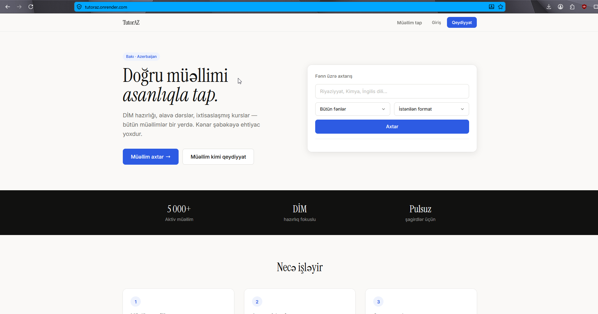

<p align="center">
  
</p>

# TutorAZ MVP

All-in-one tutor platform for Azerbaijan — tutor profiles, student search, group management, course creation.

🌐 **Live site:** [https://tutoraz.onrender.com/](https://tutoraz.onrender.com/)


## Stack

- **Backend**: Flask 3 + SQLAlchemy + Flask-Migrate
- **DB**: PostgreSQL (SQLite for local dev)
- **Frontend**: Jinja2 templates + Tailwind CSS (CDN)
- **Deploy**: Render.com
- **CI/CD**: GitHub Actions

## MVP Features (ICE top 3)

1. **Tutor profile creation** — tutors build public profiles with subjects, bio, pricing, phone, avatar
2. **Student search & discovery** — filter by subject, format (online/in-person), city
3. **Group creation** — tutors create groups with weekly schedule slots, students join via invite codes

## Course marketplace (Phase 2)

Tutors can package recorded lessons into paid or free courses:
- Course → Sections (e.g. "Optics", "Electromagnetism") → Lessons (video + optional homework/answer key)
- Students browse courses separately from tutor search, buy via Stripe Checkout (test mode)
- Payouts via **Stripe Connect Express** — platform takes a configurable % fee, rest goes straight to tutor's connected account
- Bank details are never stored by us — Stripe's hosted onboarding handles that

## Local Setup

```bash
# 1. Clone & install
git clone <repo>
cd tutoraz
python -m venv venv && source venv/bin/activate
pip install -r requirements.txt

# 2. Configure
cp .env.example .env
# Edit .env → set DATABASE_URL (or leave blank for SQLite)

# 3. Database
flask db init       # first time only
flask db migrate -m "initial"
flask db upgrade

# 4. Run
python run.py
# → http://localhost:5000
```

## Project Structure

```
tutoraz/
├── app/
│   ├── __init__.py          # App factory
│   ├── models/
│   │   ├── user.py          # User (tutor + student)
│   │   ├── tutor.py         # TutorProfile, Subject
│   │   └── group.py         # Group, GroupMember
│   ├── routes/
│   │   ├── auth.py          # Register / Login / Logout
│   │   ├── main.py          # Landing + Dashboard
│   │   ├── tutor.py         # Profile edit + public view
│   │   ├── student.py       # Search
│   │   └── groups.py        # Group CRUD + join
│   └── templates/           # Jinja2 templates
├── tests/
├── migrations/
├── render.yaml              # Render deployment config
├── gunicorn.conf.py
├── requirements.txt
└── run.py
```

## Future (Anti-Roadmap)

- Rating & review system
- Lesson scheduling
- In-app messaging
- File sharing / homework
- Payment integration (Stripe / local gateway)
- Verified DIM results
- Mobile app (Flutter)
